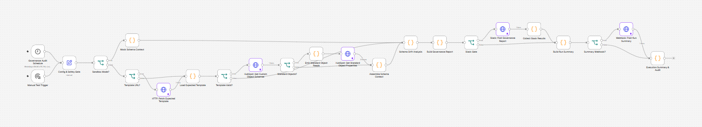

<div align="center">

# n8n-hubspot-custom-object-schema-drift-detector

**Scheduled governance audit that inspects HubSpot custom object definitions and property associations against expected templates, alerting RevOps of unexpected schema changes.**

A dhRobin Systems Revenue Infrastructure blueprint

     

</div>

---

## Table of Contents

1. [Overview](#1-overview)
2. [Architecture and Data Flow](#2-architecture-and-data-flow)
3. [Repository Contents](#3-repository-contents)
4. [Prerequisites](#4-prerequisites)
5. [5-Minute Sandbox Quick Start](#5-5-minute-sandbox-quick-start)
6. [Step-by-Step Import and Configuration Guide](#6-step-by-step-import-and-configuration-guide)
7. [The Expected Schema Template](#7-the-expected-schema-template)
8. [Environment Variables](#8-environment-variables)
9. [Node-by-Node Configuration Guide](#9-node-by-node-configuration-guide)
10. [Schema Comparison Rules and Drift Severity Matrix](#10-schema-comparison-rules-and-drift-severity-matrix)
11. [False-Positive Protections](#11-false-positive-protections)
12. [Governance Best Practices](#12-governance-best-practices)
13. [Safety Matrix](#13-safety-matrix)
14. [Data Protection and Compliance Checklist](#14-data-protection-and-compliance-checklist)
15. [Operations and Troubleshooting](#15-operations-and-troubleshooting)
16. [Disclaimer and License](#16-disclaimer-and-license)

---

## 1. Overview

Custom objects are where a HubSpot portal holds the business model that standard objects can't: projects, contracts, assets, subscriptions. Integrations, workflows, reports and forms all depend on those definitions staying put.

They don't. A super admin changes a number property to text to "fix" an import. A dropdown option is deleted because nobody uses it this quarter. A required field is switched off, or a new one is switched on, breaking every integration that creates records without it. An association label is removed. None of this throws an error in HubSpot. It surfaces weeks later as a broken sync, a wrong report or a failed record create.

I built this workflow as a scheduled audit against a versioned master template. Every run, it reads the live custom object schemas and the standard object properties you manage. It compares them with the template field by field and reports each discrepancy with a severity, the expected value and the actual value. RevOps gets one Slack governance report with links to the affected property settings. A JSON summary is also available for GRC, ticketing or BI tools.

**What it detects**

| Area | Discrepancies |
|---|---|
| Custom objects | Missing or archived objects, unmanaged (unexpected) objects, label changes, primary display property changes |
| Required flags | Required property no longer required; new required property not in the template |
| Properties | Deleted or archived properties, type mutations, field type changes, removed or hidden enumeration options, new options, unique-value flag changes, label changes, unmanaged properties, mass property loss |
| Associations | Expected association missing; association not in the template |
| Audit health | Template missing or invalid, HubSpot read failures, unreadable objects |

**Design principles**

| Principle | Implementation |
|---|---|
| Read-only | The workflow only calls `GET` endpoints on HubSpot. It never creates, changes or deletes a schema, property or record. |
| Safe by default | With no environment variables set, it makes **zero HubSpot calls and zero Slack calls**. Alerts need `SANDBOX_MODE=false`, `DRY_RUN=false` and `SEND_SLACK_ALERTS=true`. |
| Template as code | The expected schema is a JSON file you keep in version control and review like code ([§7](#7-the-expected-schema-template)). |
| No false all-clear | A failed template load or HubSpot read is an audit failure with its own alert, never a "no drift" result. |
| Unreadable is not deleted | An object that couldn't be read is reported as unreadable, and its earlier findings are carried over. It is never reported as deleted. |
| Signal over noise | Findings are tracked between runs: alerts go out for new drift, a reminder for open critical drift, and resolved drift. An unchanged report isn't repeated every morning. |
| Secrets out of data | The HubSpot token and webhook URLs appear only as `{{ $env.* }}` in HTTP header and URL fields. No Code node reads a secret. |

---

## 2. Architecture and Data Flow

```mermaid
flowchart LR
    SCH[Governance Audit Schedule<br/>weekdays 05:40 UTC] --> CFG
    MAN[Manual Test Trigger] --> CFG[Config & Safety Gate]
    CFG --> SB{Sandbox Mode?}
    SB -- yes --> MOCK[Mock Schema Context<br/>sample-payloads/hubspot-schema-definitions.json]
    SB -- no --> TU{Template URL?}
    TU -- yes --> FT[HTTP: Fetch Expected Template<br/>versioned JSON file] --> LT
    TU -- no --> LT[Load Expected Template<br/>URL or EXPECTED_SCHEMA_TEMPLATE_JSON]
    LT --> TV{Template Valid?}
    TV -- no --> AN
    TV -- yes --> GS[HubSpot: Get Custom Object Schemas<br/>GET /crm-object-schemas/v3/schemas]
    GS --> SO{Standard Objects?}
    SO -- yes --> ES[Emit Standard Object Reads] --> GP[HubSpot: Get Standard Object Properties<br/>GET /crm/v3/properties/objectType] --> ASM
    SO -- no --> ASM[Assemble Schema Context]
    MOCK --> AN
    ASM --> AN[Schema Drift Analysis<br/>rules · severity · new / persisting / resolved]
    AN --> REP[Build Governance Report<br/>Slack Block Kit + settings links]
    REP --> SG{Slack Gate}
    SG -- yes --> SP[Slack: Post Governance Report] --> CS[Collect Slack Results] --> SUM
    SG -- no --> SUM[Build Run Summary<br/>+ record state]
    SUM --> SW{Summary Webhook?}
    SW -- yes --> WH[Webhook: Post Run Summary] --> AUD
    SW -- no --> AUD[Execution Summary & Audit]
```





### Stage contracts

| Stage | Output shape |
|---|---|
| Load Expected Template | `{ template, templateSource: url \| env, templateErrors[], valid, standardObjects[] }` |
| Mock Schema Context / Assemble Schema Context | `{ source, portalId, template, templateSource, templateErrors, actual: { customObjects[] (HubSpot schema objects), standardObjects: { deals: { properties[], readError } } }, readErrors[] }` |
| Schema Drift Analysis | `{ status: pass \| drift \| fail \| error, auditError, templateVersion, templateWarnings[], objects[{ key, kind, objectTypeId, state }], findings[{ key, rule, severity, object, property, message, expected, actual, status: new \| persisting, firstSeenAt, changedAt }], resolved[], counts, alert: { needed, reason }, notes[], templateSnapshot? }` |
| Build Governance Report | `{ message: { text, blocks[] }, alertNeeded, slackAllowed }` |
| Build Run Summary | `{ body (event hubspot.schema_drift.audit), sendAllowed, recorded, delivered }` |
| Execution Summary & Audit | Outcome, safety flags, thresholds, per-object state, every finding, resolved items, delivery results |

---

## 3. Repository Contents

```
n8n-hubspot-custom-object-schema-drift-detector/
├── README.md                                 Technical documentation (this file)
├── workflow.json                             Importable n8n workflow with sticky notes and pinned synthetic payloads
├── DISCLAIMER.md                             Liability limitation and usage terms
├── LICENSE                                   MIT License
└── sample-payloads/
    └── hubspot-schema-definitions.json       Synthetic expected template + drifted actual schemas (also embedded in the sandbox node)
```

The portal ID (`99000001`), object type IDs (`2-9900101`…), fully qualified names (`p990_project`, `p990_contract`), user IDs and property names are fictitious. In a real portal, the fully qualified name has the form `p{portalId}_{name}`. The template is keyed by object **name**, so the portal prefix doesn't matter.

---

## 4. Prerequisites

| Requirement | Detail |
|---|---|
| n8n | Self-hosted **1.60 or later** (Schedule Trigger 1.2, Set 3.4, IF 2, Code 2, HTTP Request 4.2, `$('Node').isExecuted`, `v1` execution order). |
| Env access | `N8N_BLOCK_ENV_ACCESS_IN_NODE=false`, so `{{ $env.* }}` expressions resolve. |
| HubSpot plan | Custom objects require an Enterprise subscription. Standard object property audits work on any tier. |
| HubSpot private app scopes (read-only) | **`crm.schemas.custom.read`**: custom object schemas, their properties and associations. **`crm.schemas.contacts.read`**, **`crm.schemas.companies.read`**, **`crm.schemas.deals.read`** (and e.g. `crm.schemas.tickets.read`, `crm.schemas.quotes.read`, `crm.schemas.line_items.read`): one per standard object you list in the template's `standardObjects`. Grant only the ones you audit. **No write scopes.** |
| Expected template | A JSON file ([§7](#7-the-expected-schema-template)), served from a URL n8n can reach (a raw file in your Git host, object storage, an internal file server) or pasted into `EXPECTED_SCHEMA_TEMPLATE_JSON`. |
| Slack | An incoming webhook for the RevOps governance channel. |

> **n8n Cloud:** you can't define your own environment variables there. Replace `$env.X` with `$vars.X` (on plans with Variables) or n8n credentials. The workflow logic is unchanged.

---

## 5. 5-Minute Sandbox Quick Start

1. **Run n8n locally:**
   ```bash
   docker run -it --rm -p 5678:5678 \
     -e N8N_BLOCK_ENV_ACCESS_IN_NODE=false \
     -e GENERIC_TIMEZONE=UTC \
     -v n8n_data:/home/node/.n8n \
     docker.n8n.io/n8nio/n8n
   ```
2. **Import** `workflow.json` (*Workflows → Import from File*).
3. Click **Test workflow** on *Manual Test Trigger*.
4. Open **Schema Drift Analysis**, **Build Governance Report** and **Execution Summary & Audit**.

**Expected sandbox result:** status `fail`, 6 objects audited, **8 critical · 9 warning · 11 info**, outcome `drift_found_sandbox`, nothing sent.

| Object | Findings |
|---|---|
| **Project** (`p990_project`) | 🔴 `budget_amount` type number → string · 🔴 `delivery_owner_email` deleted · 🔴 `project_stage` no longer required · 🔴 `project_stage` option `on_hold` removed · 🔴 association to Contract missing · 🟠 `project_code` unique flag removed · 🔵 `project_name` label changed · 🔵 new option `cancelled` · 🔵 2 unmanaged properties · 🔵 extra association to Tickets |
| **Contract** (`p990_contract`, locked object) | 🔴 `termination_reason` archived · 🟠 primary display property changed · 🟠 `renewal_terms` field type textarea → text · 🟠 `signed_by` newly required · 🟠 `signed_by` and `notes_misc` added to a locked object |
| **Asset** | 🔴 Custom object missing |
| **Vendor scorecard** (`p990_vendor_scorecard`) | 🟠 Unmanaged custom object |
| **Deals** (standard) | 🔴 `arr_amount` deleted · 🟠 option `plus` hidden · 🟠 6 unmanaged properties (threshold 5) · 🔵 the 6 properties |
| **Companies** (standard) | ✅ Matches the template |

The Slack report lists the 17 critical and warning findings grouped by object, critical first, with a **Property settings** button per object (set `HUBSPOT_PORTAL_ID` to see the buttons in the sandbox). The 11 info findings are counted in the footer.

---

## 6. Step-by-Step Import and Configuration Guide

Each step changes one thing and has an exit check.

| Step | Configuration | Exit check |
|---|---|---|
| **1. Import and sandbox** | Defaults | The result in [§5](#5-5-minute-sandbox-quick-start) is reproduced. |
| **2. Pinned live path** | `SANDBOX_MODE=false`, `HUBSPOT_ACCESS_TOKEN=synthetic`, `EXPECTED_SCHEMA_TEMPLATE_URL=https://git.example.com/revops/hubspot-schema.json`, `HUBSPOT_PORTAL_ID=99000001`. Run **Test workflow** | Every node runs on pinned synthetic responses with the same 8 / 9 / 11 result. Outcome `drift_found_dry_run`. Nothing leaves n8n. |
| **3. Bootstrap your template** | Create the private app with the read scopes ([§4](#4-prerequisites)). Unpin both HubSpot nodes (*right-click → Unpin*). Real token, a minimal template (e.g. `{"customObjects":{}}`) in `EXPECTED_SCHEMA_TEMPLATE_JSON`, `GENERATE_TEMPLATE_SNAPSHOT=true` | **Execution Summary & Audit** contains `templateSnapshot` built from your portal. |
| **4. Curate and version the template** | Review the snapshot: remove properties you don't want to govern, add `requiredProperties`, `allowUnmanagedProperties`, options and associations as policy. Commit it to Git and set `EXPECTED_SCHEMA_TEMPLATE_URL` (plus `SCHEMA_TEMPLATE_AUTH_TOKEN` if the repo is private) | Unpin *HTTP: Fetch Expected Template*. The audit runs with status `pass`, or with drift you can explain. |
| **5. Tune thresholds** | `ALERT_MIN_SEVERITY`, `SEVERITY_OVERRIDES`, `IGNORE_PROPERTY_PATTERNS`, `UNMANAGED_PROPERTY_WARN_COUNT` | The report shows what RevOps should act on, and nothing else. |
| **6. Slack** | Unpin *Slack: Post Governance Report*. `DRY_RUN=false`, `SEND_SLACK_ALERTS=true`, `SLACK_GOVERNANCE_WEBHOOK_URL` of a test channel | The report arrives, and its buttons open the right property settings. |
| **7. Schedule** | Activate the workflow (cron `40 5 * * 1-5`; use `40 5 * * 1` for weekly) | The first scheduled run alerts on all open drift. Later runs alert only on new or resolved drift, plus a critical reminder every `REMINDER_HOURS`. |

---

## 7. The Expected Schema Template

The template is the governed definition of your data model. Every key is optional except that the template needs `customObjects`, `standardObjects` or both. Object and property keys are internal names (case-insensitive).

```json
{
  "templateVersion": "2026.11.1",
  "managedBy": "RevOps Governance",
  "allowUnmanagedObjects": false,
  "customObjects": {
    "project": {
      "labels": { "singular": "Project", "plural": "Projects" },
      "primaryDisplayProperty": "project_name",
      "requiredProperties": ["project_name", "project_stage"],
      "allowUnmanagedProperties": true,
      "properties": {
        "project_name":  { "type": "string", "fieldType": "text", "label": "Project name" },
        "project_stage": { "type": "enumeration", "fieldType": "select", "options": ["planning", "in_progress", "on_hold", "completed"] },
        "budget_amount": { "type": "number", "fieldType": "number" },
        "project_code":  { "type": "string", "fieldType": "text", "hasUniqueValue": true }
      },
      "associations": [{ "to": "companies" }, { "to": "contacts" }, { "to": "contract" }]
    }
  },
  "standardObjects": {
    "deals": {
      "allowUnmanagedProperties": true,
      "properties": {
        "arr_amount":    { "type": "number", "fieldType": "number" },
        "contract_tier": { "type": "enumeration", "fieldType": "select", "options": ["standard", "plus", "enterprise"] }
      }
    }
  }
}
```

| Key | Level | Meaning |
|---|---|---|
| `templateVersion` | Template | Shown in every report. Bump it on every reviewed change. |
| `allowUnmanagedObjects` | Template | `false` (default): a custom object not in the template is a **warning**. `true`: **info**. |
| `labels.singular` / `.plural` | Custom object | Checked when set. |
| `primaryDisplayProperty` | Custom object | Checked when set. |
| `requiredProperties`, or `"required": true` on a property | Custom object | When declared, required flags are checked both ways. Standard objects have no object-level required flag, so it is ignored there. |
| `allowUnmanagedProperties` | Object | Custom objects: `true` (default) reports extra properties as info; `false` locks the object (warning). Standard objects: unmanaged properties are reported **only** when this key is set, because they usually have many. |
| `properties.<name>.type` | Property | HubSpot data type: `string`, `number`, `date`, `datetime`, `enumeration`, `bool`, `phone_number`, `object_coordinates`, `json` (aliases `boolean`, `integer`, `decimal`, `enum` are accepted). |
| `properties.<name>.fieldType` | Property | UI field type (`text`, `textarea`, `number`, `select`, `radio`, `checkbox`, `booleancheckbox`, `date`, …). Checked when the type matches. |
| `properties.<name>.options` | Property | Internal option values that must exist and stay visible. `allowExtraOptions: false` makes new options a warning. |
| `properties.<name>.hasUniqueValue` | Property | Unique-value flag, checked when set. |
| `properties.<name>.label` | Property | Checked when set. |
| `associations[].to` | Custom object | Target: standard object (`contacts`, `companies`, `deals`, `tickets`, …), another custom object's name, or an object type ID. An optional `name` also requires that association name. When declared, extra associations are reported as info. |

Template sources, in priority order:

1. `EXPECTED_SCHEMA_TEMPLATE_URL`: fetched as text on every run.
2. `EXPECTED_SCHEMA_TEMPLATE_JSON`: inline JSON.

In the sandbox, the fixture's template is used.

---

## 8. Environment Variables

All variables are optional. Unset values resolve to the safest behaviour.

### 8.1 Safety gate and delivery

| Variable | Default | Effect |
|---|---|---|
| `SANDBOX_MODE` | `true` | Synthetic template and schemas. No HubSpot, Slack or webhook calls. |
| `DRY_RUN` | `true` | Live reads and full analysis. No Slack, no webhook. |
| `SEND_SLACK_ALERTS` | `false` | Explicit opt-in for Slack (also needs `SLACK_GOVERNANCE_WEBHOOK_URL`). |
| `SLACK_GOVERNANCE_WEBHOOK_URL` 🔒 | — | RevOps governance channel incoming webhook. |
| `ALERT_WEBHOOK_URL` 🔒 | — | Optional run summary JSON (outside sandbox and dry run). |
| `ALERT_WEBHOOK_TOKEN` 🔒 | — | Bearer token for it. |
| `NOTIFY_ON_EVERY_RUN` | `false` | Post the run summary even when no alert is needed. |

### 8.2 Sources

| Variable | Default | Effect |
|---|---|---|
| `HUBSPOT_ACCESS_TOKEN` 🔒 | — | Private app token (read scopes only). |
| `HUBSPOT_API_BASE_URL` | `https://api.hubapi.com` | API base URL. |
| `EXPECTED_SCHEMA_TEMPLATE_URL` | — | URL of the versioned template file. |
| `SCHEMA_TEMPLATE_AUTH_TOKEN` 🔒 | — | Bearer token for a private template URL. |
| `EXPECTED_SCHEMA_TEMPLATE_JSON` | — | Inline template (used when no URL is set). |

### 8.3 Drift thresholds and rules

| Variable | Default | Effect |
|---|---|---|
| `ALERT_MIN_SEVERITY` | `warning` | Lowest severity that triggers an alert and is listed in Slack: `critical`, `warning` or `info`. |
| `CRITICAL_FAIL_THRESHOLD` | `1` | Critical findings needed for status `fail` (otherwise `drift`). |
| `UNMANAGED_PROPERTY_WARN_COUNT` | `5` | More unmanaged properties than this on one object adds a warning. |
| `MASS_LOSS_RATIO` | `0.8` | At least 5 missing properties that are this share of an object's managed properties become one `mass_property_loss` finding. |
| `SEVERITY_OVERRIDES` | — | JSON map of rule → `critical` / `warning` / `info` / `ignore`, e.g. `{"property_label_changed":"ignore"}`. |
| `IGNORE_PROPERTY_PATTERNS` | `hs_*` | Comma-separated glob patterns never reported as unmanaged. HubSpot-defined properties are always skipped. |
| `IGNORE_OBJECTS` | — | Glob patterns of custom objects never reported as unmanaged (e.g. `p990_sandbox_*`). |

### 8.4 Alert behaviour and report content

| Variable | Default | Effect |
|---|---|---|
| `SUPPRESS_REPEAT_ALERTS` | `true` | Production runs alert only on new drift, resolved drift or the critical reminder. |
| `REMINDER_HOURS` | `168` | Reminder interval while critical drift stays open. |
| `ALERT_ON_RESOLVED` | `true` | Alert, and list in the report, findings that disappeared since the last audit. |
| `ALERT_ON_AUDIT_FAILURE` | `true` | Alert when the template or HubSpot can't be read. |
| `INCLUDE_INFO_IN_SLACK` | `false` | List info findings in Slack (always in the audit log). |
| `MAX_LINES_PER_OBJECT` | `8` | Findings per object in Slack before "+N more". |
| `SHOW_CHANGED_BY` | `false` | Include the HubSpot user ID that last changed a property. |
| `GENERATE_TEMPLATE_SNAPSHOT` | `false` | Add a template built from the live portal to the audit output (bootstrap). |
| `HUBSPOT_PORTAL_ID` | — | Builds the property-settings links. No buttons without it. |
| `HUBSPOT_APP_HOST` | `app.hubspot.com` | e.g. `app-eu1.hubspot.com` for EU-hosted portals. |
| `HUBSPOT_PROPERTY_SETTINGS_URL_TEMPLATE` | `https://{appHost}/property-settings/{portalId}/properties?type={objectTypeId}` | Per-object settings link. Verify it in your portal and override if HubSpot changes the path. |
| `HUBSPOT_DATA_MODEL_URL` | — | Optional extra button (e.g. your portal's data model overview page). |

🔒 = secret. Inject from a secret manager, never commit.

### 8.5 Sample `.env` (staging)

```bash
# n8n runtime
N8N_BLOCK_ENV_ACCESS_IN_NODE=false

# Safety gate: live reads, Slack to a test channel
SANDBOX_MODE=false
DRY_RUN=false
SEND_SLACK_ALERTS=true

# Template and thresholds
EXPECTED_SCHEMA_TEMPLATE_URL=https://git.example.com/revops/hubspot-schema/raw/main/template.json
ALERT_MIN_SEVERITY=warning
UNMANAGED_PROPERTY_WARN_COUNT=5
SEVERITY_OVERRIDES={"property_label_changed":"info","association_unmanaged":"ignore"}
IGNORE_PROPERTY_PATTERNS=hs_*,zz_test_*

# Report
HUBSPOT_PORTAL_ID=
SHOW_CHANGED_BY=false

# Secrets (inject from your secret manager; never commit)
HUBSPOT_ACCESS_TOKEN=
SCHEMA_TEMPLATE_AUTH_TOKEN=
SLACK_GOVERNANCE_WEBHOOK_URL=
ALERT_WEBHOOK_URL=
ALERT_WEBHOOK_TOKEN=
```

---

## 9. Node-by-Node Configuration Guide

### 9.1 Triggers and Config & Safety Gate

**Governance Audit Schedule** runs on weekdays at 05:40 UTC, so the report is waiting when the team starts. **Config & Safety Gate** parses the JSON variables (invalid template JSON becomes an audit failure, invalid overrides are ignored), clamps numbers, validates hosts and URL templates, and records only whether each secret or URL is set.

### 9.2 Template load

**HTTP: Fetch Expected Template** requests the file as text, with `Authorization: Bearer $SCHEMA_TEMPLATE_AUTH_TOKEN` when set. **Load Expected Template** parses it, or falls back to the inline JSON, and extracts the standard objects to read. **Template Valid?** sends any failure straight to the analysis as an audit failure, so HubSpot is not called with nothing to compare against.

### 9.3 HubSpot reads (read-only)

| Node | Call | Scope |
|---|---|---|
| HubSpot: Get Custom Object Schemas | `GET /crm-object-schemas/v3/schemas?includePropertyDefinitions=true&includeAssociationDefinitions=true` | `crm.schemas.custom.read` |
| HubSpot: Get Standard Object Properties | `GET /crm/v3/properties/{objectType}`, one call per standard object in the template | `crm.schemas.<object>.read` |

Both use `continueRegularOutput`. **Assemble Schema Context** turns a failed custom object read into an audit failure, and a failed standard object read into `object_not_readable` for that object only.

### 9.4 Schema Drift Analysis

Implements [§10](#10-schema-comparison-rules-and-drift-severity-matrix) and [§11](#11-false-positive-protections). Each finding has a stable key (`object:rule:property[:detail]`). Findings are compared with the previous production audit (workflow static data) and marked `new` or `persisting`. Keys from the previous audit that are no longer found become `resolved`. The node then decides whether to alert:

| Situation | Alert reason |
|---|---|
| No findings at or above `ALERT_MIN_SEVERITY` | None (`no_drift` / `below_alert_threshold`) |
| Manual run or `SUPPRESS_REPEAT_ALERTS=false` | `drift`: every run with alertable drift |
| New alertable finding | `new_drift` |
| Open critical drift and `REMINDER_HOURS` since the last alert | `critical_reminder` |
| Alertable findings resolved | `drift_resolved` |
| Otherwise | None (`repeat_suppressed`) |
| Template or HubSpot read failure | `audit_failure` (with `ALERT_ON_AUDIT_FAILURE=true`) |

### 9.5 Governance report (Slack)

- **Header:** `🔴 Schema drift: FAIL · 8 critical · 9 warning · 11 info`.
- **Summary line:** objects audited, alert reason, read-health notes.
- **One section per object** (critical first):
  - object label, fully qualified name and object type ID;
  - each discrepancy with expected → actual, marked *new* in production;
  - schema last-modified time;
  - a **Property settings** button.
- **Resolved section and footer:** resolved items since the last audit, then a footer with the portal, template version and source, run ID and the number of lower-severity findings.

An audit failure sends `⚠️ HubSpot schema audit could not run` with the reasons and an explicit "this is not an all-clear".

### 9.6 Run summary, state and audit

**Build Run Summary** creates `event: "hubspot.schema_drift.audit"` with status, counts and every finding (rule, severity, object, property, expected, actual, status). It records the findings in workflow memory only for production executions, and only when the alert was delivered or not needed. An undelivered finding stays `new` and is alerted on the next run.

**Execution Summary & Audit** outcomes: `no_drift`, `drift_below_alert_threshold`, `drift_alert_suppressed`, `drift_found_sandbox`, `drift_found_dry_run`, `drift_found_alerts_disabled`, `drift_alerted`, `drift_alert_failed`, `audit_failed_template`, `audit_failed_hubspot_read`, `audit_failed_alerted`.

---

## 10. Schema Comparison Rules and Drift Severity Matrix

| Rule | Detects | Default severity | Why |
|---|---|:---:|---|
| `object_missing` | Template custom object not returned | 🔴 critical | Records, integrations and reports on that object are broken |
| `object_archived` | Custom object archived | 🔴 critical | Same, recoverable for a limited time |
| `property_missing` | Managed property deleted or renamed | 🔴 critical | Writes to it fail, and its values are gone from reports |
| `property_archived` | Managed property archived | 🔴 critical | As above |
| `mass_property_loss` | ≥ 5 and ≥ `MASS_LOSS_RATIO` of an object's managed properties missing | 🔴 critical | Possible bulk deletion, or a wrong portal or scope. Verify first |
| `property_type_changed` | Data type changed (e.g. number → string) | 🔴 critical | Breaks calculations, filters, rollups and integration mappings |
| `property_option_removed` | Enumeration option value deleted | 🔴 critical | Writes with that value fail; historical values orphaned |
| `required_flag_removed` | Required property no longer required | 🔴 critical | Incomplete records enter the CRM |
| `association_missing` | Expected association not defined | 🔴 critical | Association writes and associated-record reports fail |
| `property_field_type_changed` | UI field type changed (same data type) | 🟠 warning | Changes forms and imports; may allow free text |
| `property_option_hidden` | Expected option hidden from the UI | 🟠 warning | Users can't select it; integrations can still write it |
| `property_unique_changed` | Unique-value flag changed | 🟠 warning | Duplicate protection lost or new conflicts on create |
| `primary_display_changed` | Primary display property changed | 🟠 warning | Record names change in views, lookups and Slack/email notifications |
| `required_flag_added` | New required property not in the template | 🟠 warning | Integrations creating records without it start failing |
| `object_unmanaged` | Custom object not in the template | 🟠 warning (info with `allowUnmanagedObjects`) | Unreviewed data model change, possibly a licence-limited slot |
| `property_unmanaged_locked` | New property on a locked object | 🟠 warning | Policy violation on a governed object |
| `property_option_added_locked` | New option on a property with `allowExtraOptions: false` | 🟠 warning | Values outside the reporting taxonomy |
| `unmanaged_property_volume` | More unmanaged properties than `UNMANAGED_PROPERTY_WARN_COUNT` | 🟠 warning | Property sprawl |
| `object_not_readable` | Object or its properties couldn't be read | 🟠 warning | Audit coverage gap (usually a scope) |
| `property_label_changed` | Property label changed | 🔵 info | Cosmetic; can confuse users and exports |
| `object_label_changed` | Object singular or plural label changed | 🔵 info | Cosmetic |
| `property_option_added` | New enumeration option | 🔵 info | Usually additive |
| `property_unmanaged` | Property not in the template | 🔵 info | Candidate for adoption into the template |
| `association_unmanaged` | Association not in the template | 🔵 info | Candidate for adoption into the template |

**Audit status:** `fail` when critical findings ≥ `CRITICAL_FAIL_THRESHOLD`; `drift` when any critical or warning finding exists; `pass` otherwise; `error` when the audit couldn't run.

Every rule can be raised, lowered or ignored with `SEVERITY_OVERRIDES`.

---

## 11. False-Positive Protections

| Risk | Protection |
|---|---|
| A token or scope problem looks like mass deletion | A failed read is an audit failure or `object_not_readable`, never a deletion. HubSpot returning no custom objects at all adds an explicit note to check the portal and scope. |
| Properties not included in a response | If a schema arrives without a `properties` array, property and required-flag checks are skipped for that object, with a warning. |
| Partial or wrong responses | `mass_property_loss` replaces a flood of per-property criticals with one finding that says to verify before restoring anything. |
| Read errors "resolve" earlier findings | Findings of unreadable objects are carried over in memory, not marked resolved. |
| HubSpot-defined and system properties | `hubspotDefined` properties and `IGNORE_PROPERTY_PATTERNS` (default `hs_*`) are never reported as unmanaged. |
| Standard objects with hundreds of properties | Unmanaged standard object properties are reported only when the template opts in with `allowUnmanagedProperties`. |
| Option label edits | Options are compared by internal value, not label; a renamed label isn't a removal. |
| Case and alias noise | Names and values are compared case-insensitively; `boolean`, `integer`, `decimal` and `enum` are accepted as type aliases. |
| Portal prefix in names | Objects are matched by name, fully qualified name or object type ID. |
| Association direction | An association counts in either direction (`from`→`to` or `to`→`from`). |
| Daily repetition | Unchanged drift isn't re-alerted; new, resolved and reminder alerts only. |
| Template mistakes | Unknown types, unsupported standard objects and unknown association targets become template warnings in the audit, not findings. |

---

## 12. Governance Best Practices

- **Treat the template as code.** Keep it in Git, change it only through a reviewed pull request, and bump `templateVersion`. The audit then always compares the portal with an approved definition.
- **Change the template first.** A planned schema change starts with a template PR. The portal change follows, and the next audit should come back `pass`.
- **Bootstrap, then curate.** `GENERATE_TEMPLATE_SNAPSHOT=true` gives you a starting point. Govern what integrations, reports and automations depend on, not every property.
- **Lock what integrations write to.** Set `allowUnmanagedProperties: false` and list required properties and enumeration options for objects that sync to ERP, billing or data warehouses.
- **Limit who can change schemas.** Restrict *Edit property settings* and custom object permissions in HubSpot to a small admin group; the audit detects drift, it doesn't prevent it.
- **Route criticals to an owner.** Send the run summary webhook to your ticketing or GRC tool so every critical finding has an owner and a due date.
- **Watch the "not an all-clear" message.** A run that couldn't complete is an incident for the audit itself.

---

## 13. Safety Matrix

| `SANDBOX_MODE` | `DRY_RUN` | `SEND_SLACK_ALERTS` | HubSpot reads | Template fetch | Slack report | Run summary webhook | Workflow memory |
|:---:|:---:|:---:|:---:|:---:|:---:|:---:|:---:|
| `true` *(default)* | any | any | No (fixture) | No | No | No | Not written |
| `false` | `true` *(default)* | any | Yes (GET only) | Yes | No | No | Written (production runs, no alert needed) |
| `false` | `false` | `false` *(default)* | Yes (GET only) | Yes | No | Yes, if URL set | Written when no alert is needed |
| `false` | `false` | `true` | Yes (GET only) | Yes | **Yes** | Yes, if URL set | Written after delivery |

**HubSpot writes: none in any mode.** The workflow has no write calls, and the private app needs no write scopes. **Pinned data:** pins apply only to manual executions. Scheduled production runs always call live endpoints according to this matrix.

---

## 14. Data Protection and Compliance Checklist

The workflow reads schema metadata only (object definitions, property definitions, option values, associations), never CRM records.

| Data element | Read | In Slack | In run summary / audit |
|---|:---:|:---:|:---:|
| Object and property names, types, labels, options | ✓ | ✓ | ✓ |
| Schema and property modification timestamps | ✓ | ✓ (object level) | ✓ |
| HubSpot user ID that last changed a property | ✓ | Only with `SHOW_CHANGED_BY=true` | Only with `SHOW_CHANGED_BY=true` |
| Record data (contacts, companies, deals, custom records) | ✗ | ✗ | ✗ |

- [ ] **Option values and labels** don't contain personal or confidential data (some portals encode customer or employee names in dropdowns). If they do, keep the Slack channel private.
- [ ] **Changed-by user IDs** are personal data of employees. Enable `SHOW_CHANGED_BY` only with a documented purpose (change accountability) and in line with your works council or employee privacy policies.
- [ ] **Least privilege:** the private app has only `crm.schemas.*.read` scopes for the audited objects, and no write scopes.
- [ ] **Template repository access** is limited to RevOps and admins; the template describes your data model.
- [ ] **Slack channel** is private, limited to RevOps and CRM admins.
- [ ] **Execution data** retention is set (`EXECUTIONS_DATA_PRUNE=true`, a sensible `EXECUTIONS_DATA_MAX_AGE`).
- [ ] **Secrets** are injected from a secret manager and rotated if an execution export leaves your team.
- [ ] **Version control hygiene:** before committing an edited workflow, run:

```bash
grep -nE '(pat-[a-z0-9]{2}-[a-f0-9-]{20,}|hooks\.slack\.com/services/[A-Z0-9]+/|Bearer [A-Za-z0-9._-]{20,})' workflow.json && echo "Possible secret found" || echo "Clean"
```

---

## 15. Operations and Troubleshooting

### 15.1 Call volume per run

| Calls | Count |
|---|---|
| Template fetch | 1 (URL source) |
| HubSpot | 1 schemas call + 1 per standard object in the template |
| Slack | 0 or 1 |
| Run summary webhook | 0 or 1 |

### 15.2 Troubleshooting

| Symptom | Likely cause | Fix |
|---|---|---|
| `audit_failed_template`: "did not return valid JSON" | URL returns an HTML page (login, 404) | Use the raw file URL; set `SCHEMA_TEMPLATE_AUTH_TOKEN` for private repos. |
| `audit_failed_hubspot_read` with 401/403 | Token invalid or missing `crm.schemas.custom.read` | Fix the token or scope and re-install the private app. |
| Every custom object `object_missing` | Token from another portal, or no custom objects visible | Check the note in the report; compare `HUBSPOT_PORTAL_ID` with the token's portal. |
| `object_not_readable` for a standard object | Missing `crm.schemas.<object>.read` | Add the scope, or remove the object from the template. |
| `property_field_type_changed` on every property | Template uses a different field type name | Use HubSpot's internal `fieldType` values (see a snapshot). |
| Too many info findings | Unmanaged properties on a busy object | Add them to the template, `IGNORE_PROPERTY_PATTERNS`, or override `property_unmanaged` to `ignore`. |
| Same drift alerted every morning | Manual executions, or `SUPPRESS_REPEAT_ALERTS=false` | Repeat suppression uses production runs; activate the schedule. |
| No alert after a Slack outage | Not expected | Undelivered findings stay `new`, so the next run alerts again. Check `drift_alert_failed` in the audit. |
| Settings button opens the wrong page | HubSpot changed the URL path | Override `HUBSPOT_PROPERTY_SETTINGS_URL_TEMPLATE`. |

---

## 16. Disclaimer and License

### ⚠️ Disclaimer & Liability Limitation

**Use at your own risk.** The code, workflows, and scripts in this repository (`n8n-hubspot-custom-object-schema-drift-detector`) are provided for educational and architectural demonstration purposes.

- **No Liability:** The author and dhRobin Systems accept no responsibility or liability for any direct, indirect, incidental, or consequential damages that result from using, misusing, or deploying these scripts.
- **No Warranty:** All software, n8n JSON blueprints, JavaScript modules and prompts are provided "AS IS", without warranty of any kind, express or implied. This includes, but is not limited to, warranties of merchantability, fitness for a particular purpose, and non-infringement.
- **Production Testing Required:** Always test thoroughly in an isolated staging environment, such as a HubSpot developer test account or sandbox, with `SANDBOX_MODE=true`, `DRY_RUN=true` and `SEND_SLACK_ALERTS=false` enabled, before you connect live HubSpot or Slack credentials. Treat every drift finding as a prompt for a person to investigate, not as an instruction to change or restore a schema, and confirm the cause before acting on it.
- **Third-Party APIs & Compliance:** You alone are responsible for complying with the terms of service, rate limits, data privacy regulations (GDPR/CCPA), and security policies of HubSpot, Slack and any connected services. That includes granting only the read scopes the audit needs, securing every token and webhook URL, keeping personal or confidential data out of reports and channels, and reviewing every schema change made in response to an alert.

The full disclaimer is also available in [DISCLAIMER.md](DISCLAIMER.md).

### License

Released under the MIT License. Copyright (c) 2026 DH Robin (dhRobin Systems). See [LICENSE](LICENSE).

---

Full text: DISCLAIMER.md · Licensed under the MIT License. License: MIT © 2026 dhRobin Systems · Provided as-is, see the disclaimer.
